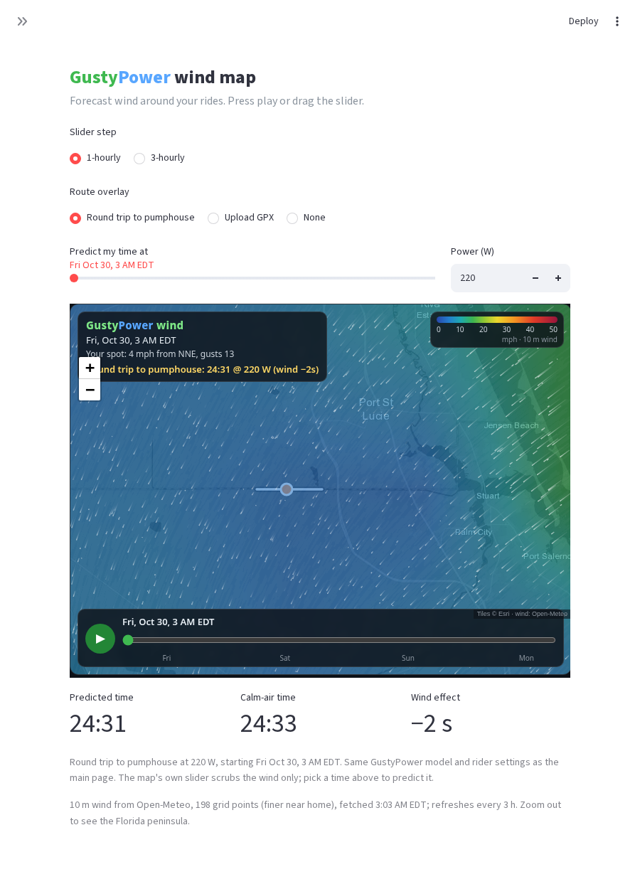

# Bike wind speed predictions

Predict ground speed on a road segment under forecast wind.

**UI flow (desktop):** left = nearby Strava segments map (geolocation / pin + explore); right = segment ID/URL + GPX + rider. Results full-width below. Connect with Strava (session token) for explore/segment loads; owner secrets token is fallback.

## Wind map page

`pages/1_Wind_Map.py` (sidebar **Wind Map**, or the link under the title) shows an
animated GustyPower wind map: Open-Meteo 10 m wind on two nested grids (Florida
peninsula + the home riding area near 27.206, −80.45), a 0–50 mph color scale,
moving streaks for direction, a play button, and an hourly / 3-hourly time slider
over the next ~4 days (Eastern time). The grid is cached for 3 h (~200 Open-Meteo
calls per refresh). Pick **Round trip to pumphouse** (bundled geometry in
`fixtures/segment_41392335.json`) or upload a GPX to overlay a route and get the
unchanged `predict_speeds` time for a chosen start hour.



## Experimental page

`pages/2_Experimental.py` (sidebar **Experimental**, or the link under the title)
keeps the validated production model and adds unvalidated setups beside it.
The prediction page does not call them (`SURFACE_AWARE_ENABLED` stays off).

Pick a route (Round trip to pumphouse, whatever is loaded on the prediction
page, a Strava segment URL, or a GPX), set the date and power, and press
**Compare**. The table shows production time and average speed next to each
option you turn on, plus the difference versus production. If the route has a
recorded time, that actual elapsed time is shown too.

* **Surface-aware rolling** looks up OpenStreetMap for each point (cached,
  12 s timeout). Paved uses Crr 0.0052 and Cd·A ×0.95, unpaved uses Crr 0.010,
  and unmapped points keep the production setup. A failed lookup says so and
  shows the production numbers, along with the paved / unpaved / unmapped share
  when the lookup works. Shipped tiles in `bike_wind/surface/tiles/` cover
  part of St. Lucie County, including the Round trip to pumphouse corridor,
  and are used before any network call. That segment is mostly unmapped canal
  bank, so its surface-aware time stays on the production setup. Other areas
  use a live lookup.
* **Manual bike setup** is an unvalidated Cd·A multiplier (0.85–1.10, default
  1.00) and Crr (default the production 0.0052). The preset **Aero wheels +
  road tires (unvalidated guess)** sets Cd·A ×0.95 and Crr 0.0045.

## Setup

```bash
python3 -m venv .venv
source .venv/bin/activate
pip install -r requirements.txt
```

## Run locally

```bash
streamlit run app.py
```

Open http://localhost:8501. GPX works with no Strava credentials. Use **Prefer NOAA HRRR** on CONUS routes for ~3 km wind; otherwise Open-Meteo is primary.

## Deploy (Streamlit Community Cloud)

1. Push this repo to GitHub.
2. At [share.streamlit.io](https://share.streamlit.io) → **New app**.
3. Set **Main file path** to `app.py`.
4. Add secrets / env as needed (see table below) in the app settings.
5. Python version ≥ 3.10; `requirements.txt` is picked up automatically.

No special build step beyond `pip install -r requirements.txt`.

## Environment variables / Streamlit secrets

Each setting is read from **env first**, then `st.secrets` of the same name (Streamlit Cloud typically only has secrets).

| Key | Purpose |
| --- | --- |
| `STRAVA_ACCESS_TOKEN` | Segment URL/ID + streams without OAuth UI (owner fallback; expires) |
| `STRAVA_REFRESH_TOKEN` | Refresh expired access token (session-only persist; secrets are read-only) |
| `STRAVA_CLIENT_ID` | OAuth app client id (Connect with Strava) |
| `STRAVA_CLIENT_SECRET` | OAuth app client secret |
| `STRAVA_REDIRECT_URI` | Must match Strava callback (Cloud app root URL) |
| `BIKE_WIND_HRRR` | Default `false`. Set `true` so the HRRR UI toggle defaults on |
| `BIKE_WIND_CACHE` | Root for SQLite caches (Strava + weather forecasts) |

### Streamlit Cloud + Strava OAuth

Live app: https://bike-wind-prm8ndkr5xgfmy6rxdd4tj.streamlit.app

1. Strava API settings → **Authorization Callback Domain**: `bike-wind-prm8ndkr5xgfmy6rxdd4tj.streamlit.app`
2. Cloud **Secrets** (TOML):

```toml
STRAVA_CLIENT_ID = "your_client_id"
STRAVA_CLIENT_SECRET = "your_client_secret"
STRAVA_REDIRECT_URI = "https://bike-wind-prm8ndkr5xgfmy6rxdd4tj.streamlit.app"
# or nested: [strava] CLIENT_ID / CLIENT_SECRET / REDIRECT_URI / ACCESS_TOKEN
```

3. **Reboot** the app after saving secrets → **Strava (optional)** → **Connect Strava** (or ACCESS_TOKEN). If still missing, the expander shows set/missing diagnostics (no secret values).

**Privacy:** Strava payloads/tokens are never sent to LLMs and are not application-logged. Caches live under `.cache/` (or `BIKE_WIND_CACHE`).

## Reliability / back-test notes

- Flat roads: target ~±5% predicted time vs known sustained-power files when wind/mass are right.
- Climbs: noisier (GPX grade noise) — treat as directional.
- Conservative aero: \(z_0=0.03\), tuck −15% A on descents, crosswind adds drag only.
- Open-Meteo forecasts are SQLite-cached by `(lat, lon, forecast_ts)`; HRRR samples use the same cache with `source=hrrr`.

## Tests

```bash
pytest
```

## Package layout

```
bike_wind/
  physics/     # forces + iterative velocity solver
  gpx/         # GPX → lat/lon/elev/distance streams
  weather/     # Open-Meteo, optional HRRR, forecast SQLite cache
  strava/      # URL parse, API client, OAuth, SQLite cache, rate limits
  rider.py / analysis.py / map_view.py / predict.py
app.py         # Streamlit entry (Community Cloud main file)
fixtures/ sample_route.gpx
tests/
```
